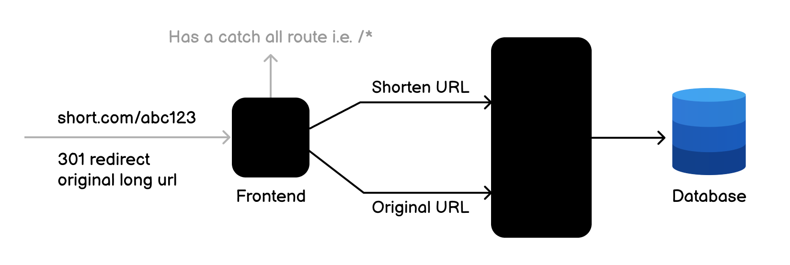

# URL Shortening Service

*Based on https://roadmap.sh/projects/url-shortening-service Project. A lot of functionalities can be extended in the
future.*

**Some functionalities were changed for convenience.**

# Introduction

You are required to create a simple RESTful API that allows users to shorten long URLs. The API should provide endpoints
to create, retrieve, update, and delete short URLs. It should also provide statistics on the number of times a short URL
has been accessed.


## Requirements

You should create a RESTful API for a URL shortening service. The API should allow users to perform the following
operations:

    - Create a new short URL

    - Retrieve an original URL from a short URL

    - Delete an existing short URL

    - Get statistics on the short URL (e.g., number of times accessed)
    
    - Redirect from the short URLs to the original URLs

    - Get a list of all short URLs

# Functionality

The application should receive a long URL and return a shortened version of it. The shortened URL should be unique and
should redirect to the original URL when accessed. The application should also keep track of the number of times each
short URL has been accessed.

When the long URL is provided, the application should clean it (to avoid unnecessary characters) up and validate it (if
exists in the table returns the same). To generate the short URL, the application must use an algorithm #TODO not
determined yet.

# Architecture

The idea of the service is simple, so the architecture will be too.

Simple layered architecture:

- Controller Layer: Handles HTTP requests and responses.
- Service Layer: Contains the business logic for URL shortening and retrieval.
- Repository Layer: Interacts with the database to store and retrieve URL data.
- Transfer "Layer": DTOs and mappers.

# API Endpoints

Base URL: `short.mateo`
Given below are the details for each API operation.

## Create Short URL

### Request

```json lines
POST /shorten
{
  "url": "https://www.google.com"
}
```

### Response

```json lines
201 CREATED
Location="/shorten/abc123"
{
  "id": "1",
  "url": "https://www.google.com",
  "shortCode": "abc123",
  "createdAt": "2021-09-01T12:00:00Z",
  "lastAccessedAt": null,
}
```

> If the URL is invalid, returns a `400 BAD_REQUEST` response.
>
> If the URL already exists, it returns a `409 CONFLICT` response with the existing short URL in the Location
> header. Based on that [comment](https://stackoverflow.com/a/70371989) on StackOverflow and the RFC 7231/9110.

## Retrieve Original URL

### Request

```json lines
GET /shorten/abc123
```

### Response

```json lines
200 OK
{
  "id": "1",
  "url": "https://www.google.com",
  "shortCode": "abc123",
  "createdAt": "2021-09-01T12:00:00Z",
  "lastAccessedAt": "2021-09-01T12:30:00Z",
}
```

> If the short URL does not exist, returns a `404 NOT_FOUND` response.

## Delete Short URL

### Request

```json lines
DELETE /shorten/abc123
```

### Response

```json lines
204 NO_CONTENT
```

> If the short URL does not exist, returns a `404 NOT_FOUND` response.

## Get URL Statistics

#TODO PENDING

### Request

```json lines
GET /shorten/abc123/stats
```

### Response

```json lines
200 OK
{
  "id": "1",
  "url": "https://www.example.com/some/long/url",
  "shortCode": "abc123",
  "createdAt": "2021-09-01T12:00:00Z",
  "lastAccessedAt": "2021-09-01T12:30:00Z",
  "accessCount": 10
}
```

> If the short URL does not exist, returns a `404 NOT_FOUND` response.

## Redirect from Short URL

### Request

```json lines
GET /abc123
```

### Response

```http request
301 MOVED_PERMANENTLY
Location: "https://www.google.com"
```

> If the short URL does not exist, returns a `404 NOT_FOUND` response.

## Get List of All Short URLs

### Request

```http request
GET /shorten?page=1&size=10&sort=createdAt,desc
```

### Response

```json lines
200 OK
{
  "meta": {
    "page": 1,
    "size": 10,
    "totalPages": 5,
    "totalElements": 50
  },
  "data": [
    {
      "id": "1",
      "url": "https://www.google.com",
      "shortCode": "abc123",
      "createdAt": "2021-09-01T12:00:00Z",
      "lastAccessedAt": "2021-09-01T12:30:00Z",
    },
    {
      "id": "2",
      "url": "https://www.example.com/some/long/url",
      "shortCode": "def456",
      "createdAt": "2021-09-02T12:00:00Z",
      "lastAccessedAt": null,
    },
    .,
    .,
    .
  ]
}
```

> It returns a list of all short URLs in the system. Pagination and sorting can be implemented as needed.
>
> Page 0 by default, size 10 by default, sorted by createdAt in descending order by default.

# Database

The tables will be created automatically by Spring Boot JDBC, defining the contract in the `schema.sql` file.

```postgresql
CREATE TABLE IF NOT EXISTS short_url
(
    id               BIGINT GENERATED ALWAYS AS IDENTITY PRIMARY KEY,
    url              VARCHAR(2048) NOT NULL,
    short_code       VARCHAR(10)   NOT NULL UNIQUE,
    created_at       TIMESTAMP DEFAULT CURRENT_TIMESTAMP,
    last_accessed_at TIMESTAMP     NULL,
    access_count     INT       DEFAULT 0
);
```

> The code above can differ from the implementation.

There are no other tables needed for this project.

If I would like to add authentication in the future, I would need to create a `user` table and a `user_short_url` table
to link users with their short URLs or something like that with API keys.

For database, I will use:

- Spring Data JDBC as data access framework.
- H2 Database for development and testing purposes.
- PostgreSQL for production.

# Deployment

The application will be deployed as a Docker container, with the PostgreSQL database running in a separate container
both mounted by a docker compose file.

I will add the step-by-step instructions to deploy the application when I finish that part.

# Authentication and Authorization

Not implemented for this project, but can be added in the future if needed.

Maybe JWT or OAuth2 (maybe overkill) can be used for authentication and authorization or an API Key (I like that).